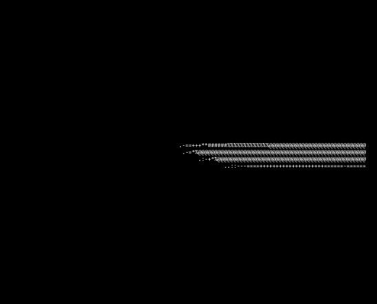

<div align="center">

# 🍎 Bad Apple!! ASCII Player

**Reproductor de video en arte ASCII con audio sincronizado**



[](https://github.com/ThroniZaphkiel/bad-apple-ascii/releases/latest)
[](LICENSE)
[](https://www.python.org/downloads/)

</div>

| | |
|---|---|
| **Autor** | Zaphkiel ([ThroniZaphkiel](https://github.com/ThroniZaphkiel)) |
| **Tipo** | Proyecto personal / hobby |
| **Lenguaje** | Python 3 (solo librería estándar) |
| **Licencia** | MIT (ver [Licencia y créditos](#15-licencia-y-créditos)) |
| **Archivo** | `bad_apple.py` |
| **Versión** | 3.0 |

---

## Descarga rápida (Windows, sin instalar Python)

1. Descarga **`BadAppleASCII-v3.0-windows.zip`** de la página de [**Releases**](https://github.com/ThroniZaphkiel/bad-apple-ascii/releases/latest) (en la sección *Assets*, al final de la página).
2. Descomprime el `.zip` en una carpeta (clic derecho → *Extraer todo*).
3. Instala FFmpeg. Abre PowerShell y escribe:
   ```powershell
   winget install ffmpeg
   ```
   (o pon `ffmpeg.exe`, `ffprobe.exe` y `ffplay.exe` junto al programa).
4. Consigue el video por tu cuenta (no viene incluido, ver [sección 3](#3-el-video-no-viene-incluido)) y guárdalo como `badapple.mp4` en la misma carpeta que el `.exe`.
5. Doble clic en **`BadAppleASCII.exe`**. También puedes arrastrar cualquier video encima del `.exe`.

> [!NOTE]
> Si Windows muestra *"Windows protegió su PC"* (SmartScreen), es porque el `.exe` no tiene firma digital: pulsa **Más información → Ejecutar de todas formas**. Si prefieres no hacerlo, usa la versión en Python ([sección 6](#6-requisitos-e-instalación)).

---

## Índice

1. [¿Qué es esto?](#1-qué-es-esto)
2. ["Bad Apple!! en todo": de dónde nace este proyecto](#2-bad-apple-en-todo-de-dónde-nace-este-proyecto)
3. [El video (no viene incluido)](#3-el-video-no-viene-incluido)
4. [Funciones](#4-funciones)
5. [Contenido de la carpeta](#5-contenido-de-la-carpeta)
6. [Requisitos e instalación](#6-requisitos-e-instalación)
7. [Uso rápido](#7-uso-rápido)
8. [Versión .exe (sin instalar Python)](#8-versión-exe-sin-instalar-python)
9. [Opciones de línea de comandos](#9-opciones-de-línea-de-comandos)
10. [Controles](#10-controles)
11. [Cómo funciona por dentro](#11-cómo-funciona-por-dentro)
12. [Rendimiento y consejos](#12-rendimiento-y-consejos)
13. [Solución de problemas](#13-solución-de-problemas)
14. [Historial de cambios e ideas](#14-historial-de-cambios-e-ideas)
15. [Licencia y créditos](#15-licencia-y-créditos)

---

## 1. ¿Qué es esto?

Un reproductor que convierte cualquier video en arte ASCII (texto) cuadro a cuadro y lo reproduce con su audio sincronizado:

- en una ventana propia (Tkinter), o
- directamente en la consola / terminal.

Tiene tres estilos de dibujo (rampa de caracteres, contornos y braille) y puede guardar la animación como un video nuevo (`.mp4`, `.gif`...) o como texto.

Lo hice por hobby, como fan de Touhou.

## 2. "Bad Apple!! en todo": de dónde nace este proyecto

"Bad Apple!!" es un tema de Touhou Project. En 2009 se publicó en Nico Nico Douga un video musical hecho solo con siluetas en blanco y negro (el *"shadow art PV"*), sobre la versión cantada de Alstroemeria Records.

Como el video es puro blanco y negro, de alto contraste y con siluetas muy claras, se convirtió en la prueba favorita para demostrar que cualquier cosa con una pantalla puede reproducir video. Igual que con *"¿corre Doom?"*, en internet existe toda una cultura de "correr Bad Apple!! en todo": osciloscopios, calculadoras gráficas, Minecraft, hojas de cálculo, el Administrador de tareas de Windows, microcontroladores con pantallas diminutas, consolas retro... y, por supuesto, la terminal en ASCII.

Este proyecto nace para eso: reproducir ese video en concreto como arte ASCII. Con el tiempo creció y ahora sirve para cualquier video, pero Bad Apple!! sigue siendo el que mejor se ve.

## 3. El video (no viene incluido)

> [!IMPORTANT]
> El video de Bad Apple!! **no** se distribuye con este proyecto: la música y la animación tienen derechos de autor de sus creadores (ver [sección 15](#15-licencia-y-créditos)).

Para usarlo:

1. Consigue por tu cuenta una copia del video (el PV de siluetas de Bad Apple!! es muy fácil de encontrar). Publicación original, en Nico Nico Douga: <https://www.nicovideo.jp/watch/sm8628149>
2. Guárdala como `badapple.mp4` en la misma carpeta que `bad_apple.py` (o que el `.exe`).
3. Ejecuta el programa.

O usa cualquier otro video:

```
python bad_apple.py "mi video.mp4"
```

El repositorio de git ignora los archivos de video (`.mp4`, `.mkv`, `.gif`...), así que nunca se suben por accidente. La única excepción es el GIF de demostración de arriba (`docs/demo.gif`): unos segundos, sin audio y ya convertidos a ASCII.

## 4. Funciones

- **Tres estilos de dibujo:**
  - `brillo`: cada carácter según el brillo: `" .:-=+*#%@"`
  - `bordes`: contornos con `/ | \ -` sobre el relleno (o solo líneas)
  - `braille`: cada carácter son 2x4 puntos (`⣿`): 8 veces más detalle
- Reproducción en ventana o en terminal, con audio sincronizado.
- Pausa, avanzar / retroceder con las flechas y barra de progreso en la que puedes hacer clic para ir a cualquier punto.
- Pantalla completa con <kbd>F11</kbd> y ajuste automático de la letra.
- Modo multicolor: cada carácter con el color del video (512 colores).
- Bucle y precarga (convierte el video una vez y lo guarda en caché).
- Exportar a `.mp4`, `.mkv`, `.webm`, `.gif` o `.txt`.
- Colores por nombre (`verde`, `ambar`...) o en hexadecimal.
- Versión `.exe` para Windows: doble clic, sin instalar Python.

## 5. Contenido de la carpeta

| Archivo | Descripción |
|---|---|
| `bad_apple.py` | El reproductor (único archivo de código). |
| `README.md` | Este archivo. |
| `CONFIGURACIONES.txt` | Referencia de todas las opciones y presets listos. |
| `construir_exe.bat` | Compila las versiones `.exe` (ver [sección 8](#8-versión-exe-sin-instalar-python)). |
| `icono.ico` | Icono del programa (una manzana hecha con ASCII). |
| `LICENSE` | Licencia MIT del código (ver [sección 15](#15-licencia-y-créditos)). |
| `docs/demo.gif` | El GIF de demostración de este README. |
| `.gitignore` | Lo que git no debe guardar (videos, caché, `.exe`). |
| `badapple.mp4` | *(No incluido; ver [sección 3](#3-el-video-no-viene-incluido).)* |
| `.cache_ascii\` | *(Se crea sola con `--precargar`.)* Se puede borrar con `python bad_apple.py --limpiar-cache` |
| `build\`, `dist\` | *(Se crean al compilar el `.exe`.)* |

## 6. Requisitos e instalación

- **Python 3.9 o superior** (probado con 3.14). Solo usa la librería estándar: no hace falta instalar nada con pip.
  - Windows: <https://www.python.org/downloads/> (marca *"Add Python to PATH"*). Tkinter ya viene incluido.
  - Linux: puede que necesites `sudo apt install python3-tk`.

- **FFmpeg**, con `ffmpeg`, `ffprobe` y `ffplay`:

  | Sistema | Comando |
  |---|---|
  | Windows | `winget install ffmpeg` |
  | Linux | `sudo apt install ffmpeg` |
  | macOS | `brew install ffmpeg` |

  También vale poner `ffmpeg.exe`, `ffprobe.exe` y `ffplay.exe` junto al programa. Para exportar a video, ffmpeg debe incluir **libass** (las versiones *"full"* de Windows y las de Linux/macOS ya lo traen).

- **Para el estilo braille:** una fuente con caracteres braille del mismo ancho que las letras. En Windows 11 se usa *Cascadia Mono*, que ya viene instalada; en Linux, *DejaVu Sans Mono*.

Comprueba que todo responde (en una terminal nueva):

```
python --version
ffmpeg -version
```

## 7. Uso rápido

```bash
python bad_apple.py                            # configuración por defecto
python bad_apple.py otro_video.mp4             # otro video
python bad_apple.py --estilo braille           # máximo detalle
python bad_apple.py --estilo bordes            # contornos
python bad_apple.py --cols 150                 # más detalle
python bad_apple.py --multicolor               # con los colores del video
python bad_apple.py --terminal                 # en la consola
python bad_apple.py --color verde              # texto verde
python bad_apple.py --bucle --precargar        # repetir, muy fluido
python bad_apple.py --exportar bad_apple_ascii.mp4
python bad_apple.py --help                     # ayuda completa
```

También puedes cambiar los valores por defecto en el bloque `CONFIGURACIÓN` del principio de `bad_apple.py`. Lo que escribas en el comando tiene prioridad. Hay presets listos para copiar en [`CONFIGURACIONES.txt`](CONFIGURACIONES.txt).

## 8. Versión .exe (sin instalar Python)

La forma más fácil: descarga los `.exe` ya compilados de la página de [Releases](https://github.com/ThroniZaphkiel/bad-apple-ascii/releases/latest) (ver [Descarga rápida](#descarga-rápida-windows-sin-instalar-python)).

Para compilarlos tú: doble clic en `construir_exe.bat` (necesita Python, solo para compilar). Crea dos programas en la carpeta `dist\`:

| Programa | Uso |
|---|---|
| `BadAppleASCII.exe` | Para doble clic. Abre la ventana directamente, sin consola. También puedes arrastrar cualquier video encima del `.exe`. |
| `BadAppleASCII-consola.exe` | Para usar desde una terminal, con todas las opciones: `--terminal`, `--exportar`, `--help`... |

Para llevarlo a otro PC, copia junto al `.exe`:

- el video (`badapple.mp4`), y
- `ffmpeg.exe`, `ffprobe.exe` y `ffplay.exe` si ese PC no tiene FFmpeg instalado (también valen dentro de una subcarpeta `ffmpeg\bin\`).

Los `.exe` no se suben al repositorio: se publican en Releases. Windows SmartScreen puede avisar de "editor desconocido" porque no están firmados: es normal en programas caseros.

## 9. Opciones de línea de comandos

```
video                   Ruta del video. Por defecto: badapple.mp4

IMAGEN
--estilo ESTILO         brillo, bordes o braille. Por defecto: brillo
--cols N                Ancho en caracteres. Por defecto: 100
--fps N                 Cuadros por segundo. Por defecto: los del video
--rampa "TEXTO"         Caracteres de oscuro a claro (brillo y bordes)
--invertir / --no-invertir        Intercambia claro y oscuro
--sensibilidad N        Estilo bordes: más bajo = más contornos. Def.: 30
--multicolor / --no-multicolor    Cada carácter con el color del video

APARIENCIA
--color COLOR           Color del texto: "#RRGGBB" o un nombre
--fondo COLOR           Color del fondo (ventana y exportación)
--letra N               Tamaño de letra inicial en la ventana. Def.: 7
--fuente NOMBRE         Tipo de letra. Por defecto: automático
--ajustar / --no-ajustar          Ajuste automático al tamaño disponible

REPRODUCCIÓN
--audio / --no-audio    Con o sin sonido (--sin-audio también funciona)
--retraso-audio S       Ajuste fino de la sincronía. Por defecto: 0
--terminal / --no-terminal        En la consola o en una ventana
--bucle / --no-bucle              Repetir al terminar
--precargar / --no-precargar      Convertir todo antes de reproducir
--limpiar-cache         Borra los videos precargados y sale

EXPORTAR
--exportar ARCHIVO      Guarda la animación: .mp4 .mkv .mov .webm .gif .txt
--alto-exportar N       Alto aproximado del video exportado. Def.: 720

FFMPEG
--ffmpeg / --ffprobe / --ffplay RUTA   Rutas si no están en el PATH
```

Explicación detallada de cada opción: [`CONFIGURACIONES.txt`](CONFIGURACIONES.txt)

## 10. Controles

**Modo ventana**

| Tecla | Acción |
|---|---|
| <kbd>Espacio</kbd> | Pausa / seguir (al terminar: repetir) |
| <kbd>←</kbd> / <kbd>→</kbd> | Retroceder / avanzar 5 segundos |
| <kbd>↑</kbd> / <kbd>↓</kbd> | Avanzar / retroceder 30 segundos |
| <kbd>Inicio</kbd> | Volver al principio |
| Clic en la barra de progreso | Ir a ese punto (también arrastrando) |
| <kbd>F11</kbd> | Pantalla completa (entrar / salir) |
| <kbd>+</kbd> / <kbd>-</kbd> | Agrandar / achicar la letra (desactiva el ajuste automático) |
| <kbd>0</kbd> | Volver al ajuste automático de la letra |
| <kbd>Esc</kbd> | Salir de pantalla completa; si no lo estás, cerrar |
| <kbd>Q</kbd> | Cerrar |

**Modo terminal**

| Tecla | Acción |
|---|---|
| <kbd>Espacio</kbd> | Pausa / seguir |
| <kbd>←</kbd> <kbd>→</kbd> <kbd>↑</kbd> <kbd>↓</kbd> | Saltar (igual que en la ventana) |
| <kbd>Inicio</kbd> | Volver al principio |
| <kbd>Q</kbd>, <kbd>Esc</kbd> o <kbd>Ctrl</kbd>+<kbd>C</kbd> | Salir |

Los saltos funcionan también en pausa: se queda en pausa mostrando el nuevo punto.

## 11. Cómo funciona por dentro

1. **Análisis.** `ffprobe` lee el ancho, el alto, los FPS, la duración y si hay audio. Las filas se calculan para mantener la proporción (un carácter es ~2 veces más alto que ancho): `filas = columnas * alto / ancho * 0.5`

2. **Decodificación** (`LectorFFmpeg` + hilo `Fuente`). ffmpeg reescala el video y entrega cada cuadro como bytes crudos. Si hacen falta varios "planos" (color, brillo, gradientes...), ffmpeg los apila uno debajo de otro en el mismo cuadro (filtro `vstack`). Un hilo los convierte y los deja en una cola de ~3 s. Para saltar, se relanza ffmpeg con `-ss` en el punto pedido.

3. **Conversión** (clase `Conversor`):
   - **brillo:** una tabla de 256 entradas asigna un carácter a cada brillo y se aplica a todo el cuadro de una vez con `str.translate`.
   - **bordes:** ffmpeg calcula los gradientes horizontal y vertical (filtro Sobel). Una tabla precalculada de 65.536 entradas convierte cada par de gradientes en `/ | \ -` según el ángulo. El borde se dibuja solo en el lado claro para que la línea tenga 1 carácter de grosor.
   - **braille:** el video se reescala a 2x4 píxeles por carácter. Cada punto se enciende si supera su umbral (una trama de Bayer de 2x4 que simula grises). Los 8 puntos se combinan con aritmética de enteros grandes, sin recorrer píxel a píxel.
   - **multicolor:** el color se reduce a 512 tonos y los caracteres seguidos del mismo color se agrupan para dibujarlos de una vez.

4. **Precarga** (opcional). Los cuadros convertidos se guardan comprimidos en `.cache_ascii\`. Hay una caché distinta por cada combinación de ajustes.

5. **Audio** (clase `Audio`). El audio se extrae a un WAV temporal y `ffplay` lo reproduce. En un MP4, `ffplay -ss` salta al fotograma clave anterior (hasta 7 s antes en `badapple.mp4`); en un WAV el salto es exacto.

6. **Sincronía** (clases `Sesion` y `Reloj`). El audio manda: `ffplay` informa cada ~30 ms del segundo que está sonando, y el reloj del video se corrige para seguirlo. Al arrancar, el video espera a que el audio suene de verdad (la primera vez `ffplay` puede tardar casi 1 s). Si el video se atrasa, salta los cuadros sobrantes. Desfase medido: unos 30 ms, que es lo que dura un cuadro.

7. **Dibujo.** Ventana: un `Label` de Tkinter, o un `Text` con 512 etiquetas de color en multicolor; al cambiar de tamaño se busca la letra más grande que cabe. Terminal: códigos ANSI de color de 24 bits; el teclado se lee sin bloquear (`msvcrt` en Windows, `termios` en Linux/macOS).

8. **Exportar.** Cada cuadro se escribe como un subtítulo ASS y ffmpeg (libass) lo dibuja sobre un fondo liso, con el audio original. Antes se mide la fuente dibujando una línea de prueba, para que el video tenga el tamaño justo. No hace falta Pillow ni ninguna otra librería.

## 12. Rendimiento y consejos

- Conversión medida a 100 columnas (cuadros por segundo; hacen falta 30):

  | Estilo | Cuadros/s |
  |---|---|
  | brillo | ~2.800 |
  | bordes | ~1.500 |
  | braille | ~2.100 |
  | multicolor (cualquier estilo) | ~550-750 |

- Precargar Bad Apple!! completo en braille tardó unos 3 s y ocupa 2,4 MB.
- Saltar con las flechas tarda menos de 0,2 s.
- Exportar Bad Apple!! completo a `.mp4` (100 columnas, 720p) tardó unos 35 s en el PC de desarrollo y ocupa unos 60 MB. Los `.gif` pesan mucho más: usa menos columnas, `--fps 15` y `--alto-exportar 360`.
- El estilo braille ya tiene mucho detalle con 80-100 columnas.
- Con el ajuste automático, solo agranda la ventana o pulsa <kbd>F11</kbd>.
- En modo terminal, maximiza la consola y achica su fuente **antes** de empezar. Windows Terminal va mucho mejor que la consola clásica.

## 13. Solución de problemas

<details>
<summary><b>"No encuentro el video: ..."</b></summary>

Falta `badapple.mp4` (no viene incluido, ver [sección 3](#3-el-video-no-viene-incluido)) o la ruta está mal. Pon la ruta completa entre comillas.
</details>

<details>
<summary><b>"Falta ffmpeg/ffprobe..."</b></summary>

Instala FFmpeg ([sección 6](#6-requisitos-e-instalación)) y abre una terminal nueva, o pon los `.exe` de FFmpeg junto al programa.
</details>

<details>
<summary><b>"Aviso: no encontré ffplay, sigo sin audio."</b></summary>

Falta `ffplay`. Instala el FFmpeg completo o usa `--ffplay RUTA`.
</details>

<details>
<summary><b>"Color no válido para --color: ..."</b></summary>

Usa `"#rrggbb"`, `"#rgb"` o uno de los nombres que muestra el mensaje.
</details>

<details>
<summary><b>El braille se ve descuadrado</b></summary>

La fuente no tiene caracteres braille del mismo ancho. Usa `--fuente "Cascadia Mono"` (Windows) o `"DejaVu Sans Mono"` (Linux). En modo terminal, cambia la fuente de la terminal.
</details>

<details>
<summary><b>El sonido y la imagen no coinciden</b></summary>

La sincronía es automática. Si aun así lo notas, ajusta `--retraso-audio`: positivo si el sonido va adelantado (p. ej. `0.05`), negativo si va atrasado (p. ej. `-0.05`).
</details>

<details>
<summary><b>La letra no cambia al agrandar la ventana</b></summary>

Pulsaste <kbd>+</kbd> o <kbd>-</kbd>, y eso desactiva el ajuste automático. Pulsa <kbd>0</kbd>.
</details>

<details>
<summary><b>En la terminal salen símbolos raros como "←[38;2;..."</b></summary>

Tu consola no admite códigos ANSI. Usa Windows Terminal o la ventana.
</details>

<details>
<summary><b>"ffmpeg no pudo generar el video"</b></summary>

Tu ffmpeg no tiene libass, o el formato no es válido. Prueba con `.mp4`.
</details>

<details>
<summary><b>En el video exportado la \ se ve un poco distinta</b></summary>

Se dibuja con el carácter `∖`, porque `\` tiene un significado especial en los subtítulos ASS.
</details>

<details>
<summary><b>BadAppleASCII.exe dice que use la versión de consola</b></summary>

La versión de doble clic solo reproduce en ventana. Para `--terminal`, `--exportar` o `--help` usa `BadAppleASCII-consola.exe` desde una terminal.
</details>

<details>
<summary><b>"No module named tkinter" (Linux)</b></summary>

```
sudo apt install python3-tk
```
</details>

## 14. Historial de cambios e ideas

**v3.0** (2026-11-21)
- [x] Estilos nuevos: bordes (contornos con `/ | \ -`) y braille (2x4 puntos por carácter, con trama para simular grises).
- [x] Avanzar / retroceder con las flechas, ir al inicio, y barra de progreso con clic (en ventana) o dibujada (en terminal).
- [x] Sincronía con el audio como reloj maestro: el video sigue a `ffplay` y espera a que el audio suene de verdad (antes, el primer arranque en frío de `ffplay` podía dejar el audio ~0,65 s atrasado).
- [x] Versión `.exe`: `BadAppleASCII.exe` (doble clic, sin consola) y `BadAppleASCII-consola.exe`, con `construir_exe.bat` e icono propio.
- [x] Opción `--fuente`; el braille elige solo una fuente compatible.
- [x] Busca el video y FFmpeg también junto al programa.
- [x] Repositorio git; el video no se incluye por derechos de autor.

**v2.0** (2026-11-21)
- [x] Pausa, pantalla completa, ajuste automático, multicolor, bucle, precarga y exportar a `.mp4` / `.gif` / `.txt`.
- [x] Opciones `--no-*` y colores por nombre.
- [x] Audio desde un WAV temporal (corrige el desfase al pausar).

**v1.0**
- Reproducción en ventana y en terminal con audio sincronizado.

**Ideas para el futuro**
- [ ] Estilo "medios bloques" (`▀▄`) con dos colores por carácter.
- [ ] Elegir la pista de audio en videos con varias.

## 15. Licencia y créditos

### Créditos

- **"Bad Apple!!"** es una composición original de ZUN (Team Shanghai Alice), del juego *Touhou Project 4: Lotus Land Story*.
- La versión cantada pertenece a **Alstroemeria Records** (feat. nomico).
- El video de sombras original es obra de sus creadores en Nico Nico Douga (**Anira** y colaboradores): <https://www.nicovideo.jp/watch/sm8628149>
- Todo el contenido de Touhou Project y la música pertenecen a sus respectivos dueños. Este es un proyecto de fans sin fines de lucro: no distribuye ni el video ni la música. Solo incluye un GIF de demostración de unos segundos, sin audio y convertido a ASCII.
- Herramientas: Python, [FFmpeg](https://ffmpeg.org) y PyInstaller.

### Licencia del código

El código (`bad_apple.py`, `construir_exe.bat`, `icono.ico`) está bajo la [licencia MIT](LICENSE). Copyright (c) 2026 Zaphkiel.

<div align="center">

---

*Hecho con cariño por Zaphkiel* 🍎

</div>
